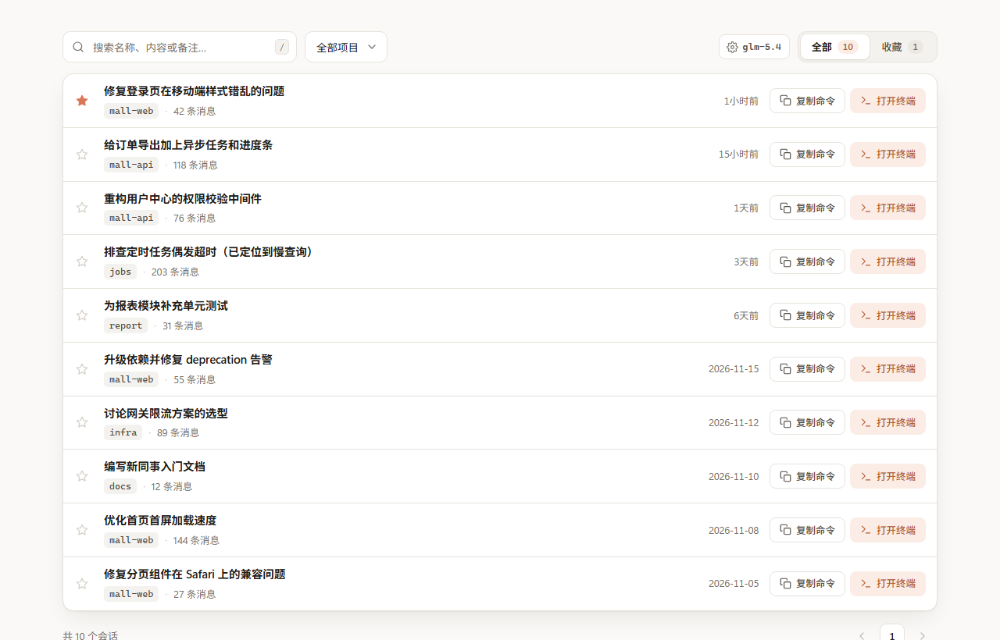
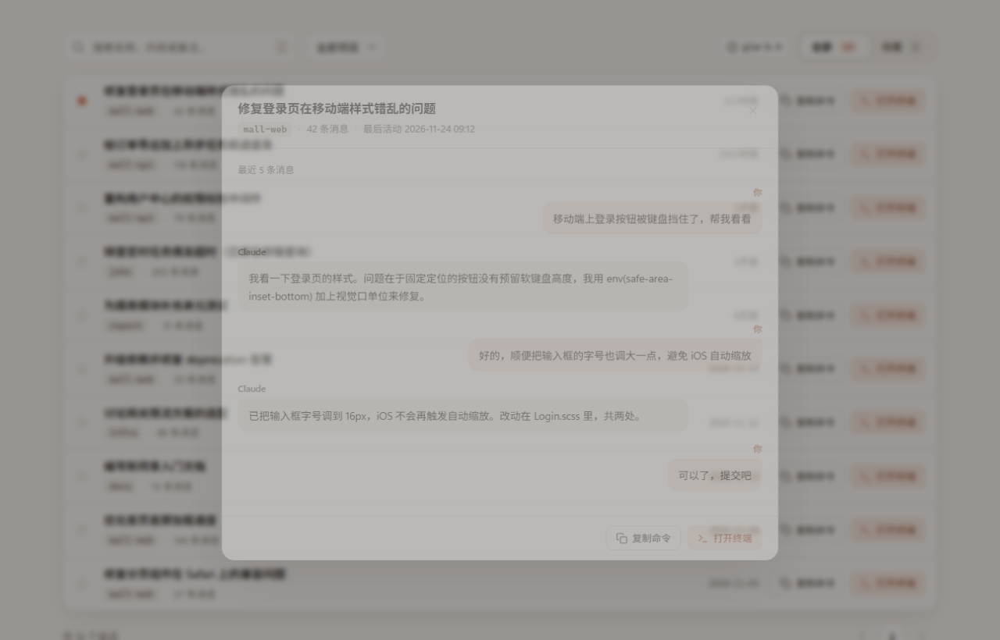
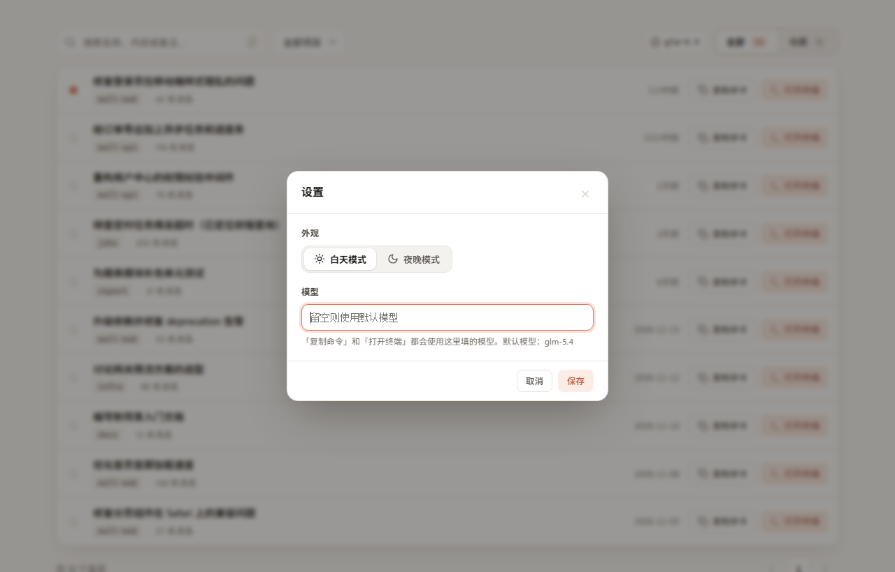
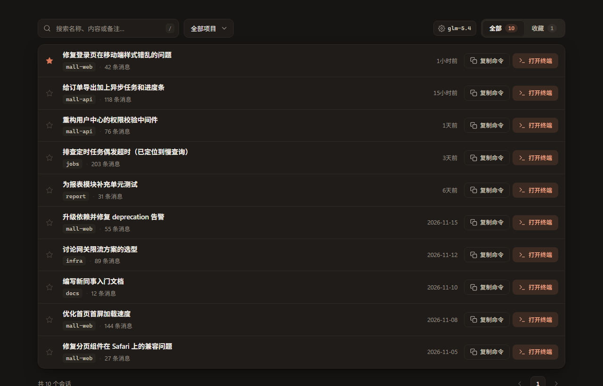

# Claude Message View

__A single-file local web service that scans Claude Code's on-machine session records for browsing, full-text search, favorites & archiving — and resumes any session in a terminal with one click (`claude --resume`).__

English · [简体中文](README_ZH.md)

---

> This is a localhost-only (127.0.0.1) tool. Claude Code stores every session as `~/.claude/projects/*/*.jsonl`, but keeps them for only 30 days by default, with no friendly UI to dig up an old one. This project turns browse / search / favorite / backup / restore into a single zero-dependency file.

## ✨ Highlights

- __🗂️ Single file, zero dependencies__ — all code lives in `app.py` (server + embedded frontend), Python stdlib only. `python app.py` and you're done.
- __🔍 Full-text search__ — search names / content / notes; typing ≥2 characters automatically scans every session record for hits (4-second budget, partial results past that; a full scan of 176MB of local transcripts takes ~2s).
- __⭐ Favorites with automatic backup__ — favorited sessions are backed up to `archive/`, so when Claude Code's 30-day cleanup deletes them they stay in your favorites list (marked "archived").
- __♻️ One-click restore__ — "Restore session" writes the archived copy back to its original path so you can resume; "Open terminal" opens a new tab in your most-recently-used Windows Terminal window and resumes with PowerShell 7 — no copy-pasting.
- __🗂️ Archive view__ — an "Archived" tab lists all backups (favorited or not), with restore / delete actions.
- __⏰ Expiry & new-session alerts__ — sessions within a week of the 30-day cleanup show "N days until cleanup"; an open page polls every 30s and notifies you of new sessions.
- __🌗 Light / dark mode__ — settings also let you customize the `--model` argument (applies to both "Copy command" and "Open terminal").

## 🖼️ Screenshots

| Main list | Session detail | Settings | Dark mode |
| --- | --- | --- | --- |
|  |  |  |  |

> All screenshots use fabricated demo data, not real sessions.

## 🧰 Requirements (verified on)

| Component | Version | Notes |
| --- | --- | --- |
| Windows | 11 (10.0.26200) | Server and registry auto-start are Windows-only |
| Python | 3.10.4 | Stdlib only, no third-party deps; 3.8+ should work |
| Claude Code | 2.1.321 | Provides the scanned session records and `claude --resume` |
| Windows Terminal | 1.25 | "Open terminal" needs `wt.exe` on PATH |
| PowerShell | 7.7.0 (pwsh) | "Open terminal" runs the resume command via pwsh |

Without Windows Terminal / pwsh, "Copy command" still works — paste it into any terminal.

## 🚀 Quick Start

```powershell
cd path\to\claude_message_view
python app.py            # runs in the foreground at http://127.0.0.1:8765
```

The server binds to `127.0.0.1` only — never exposed to the network.

### Auto-start on boot (optional)

```powershell
python app.py --install    # registry Run key + VBS launcher; starts server & opens browser on login
python app.py --uninstall  # remove auto-start
```

## 📖 Usage

1. Open `http://127.0.0.1:8765/` in a browser.
2. Find the session you want to continue (search or filter by project; press `/` to focus the search box).
3. Click "Open terminal" to resume directly, or "Copy command" to paste the full resume command (with `cd`) into any terminal.

> Note: Claude Code keeps session records for only 30 days by default (`cleanupPeriodDays`); older ones won't appear in the list — unless you favorited them, in which case they live on in the "Archived" tab.

## 🏗️ Implementation Notes

- __Incremental parsing__ — per-file parse results are cached by mtime; unmodified files are never re-read, so refreshing the page is cheap.
- __Tolerant of bad data__ — corrupt bytes/lines in a jsonl are skipped without breaking the session.
- __Security boundaries__ — resume commands only target sessions that really exist in the cache; model names are whitelist-validated before being spliced into a command line; the server listens on loopback only.

## 📂 Project Structure

```
app.py                        # all code (server + embedded frontend), ~1500 lines
docs/                         # doc screenshots (demo data)
archive/                      # backups of favorited sessions + meta.json (generated, not committed)
favorites.json                # favorites & notes (generated, not committed)
settings.json                 # page settings (model, theme) (generated, not committed)
claude_message_view_startup.vbs  # auto-start launcher (created by --install)
startup.log                   # auto-start log
```

## ⚠️ Known Limitations

- Scans only one level of `~/.claude/projects/*/*.jsonl`; subagent transcripts are not included.
- "Open terminal" targets the *last-used* Windows Terminal window (`wt -w last`); with multiple windows it depends on focus.
- Full-text search scans newest-first and stops after ~4 seconds, warning that results may be incomplete.
- Archive backups are full file copies; favoriting several large sessions uses proportional disk space in `archive/`.
- Favorites that were cleaned up before the archive feature existed (no backup copy) can't be restored — only their id and note remain.

## 📄 License

Released under the [MIT License](LICENSE).

---

Built for people who get real work done with Claude Code.

_Claude Message View — never lose a session again._
