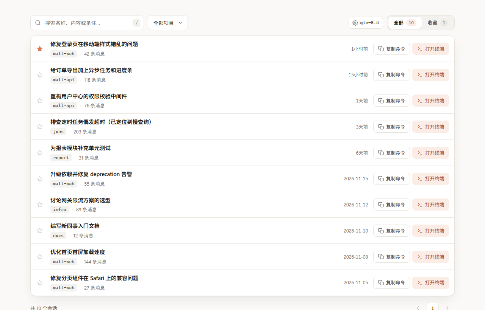
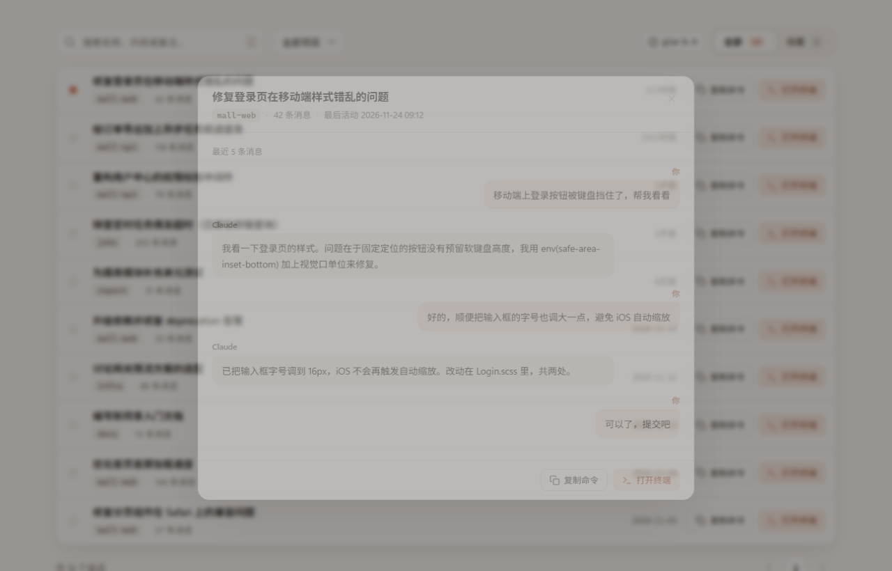
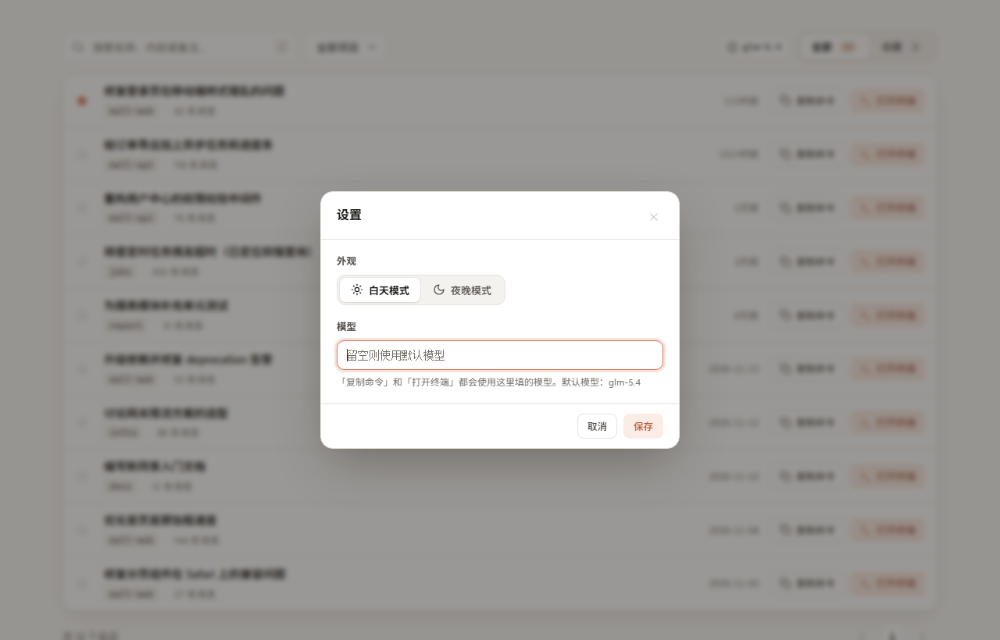
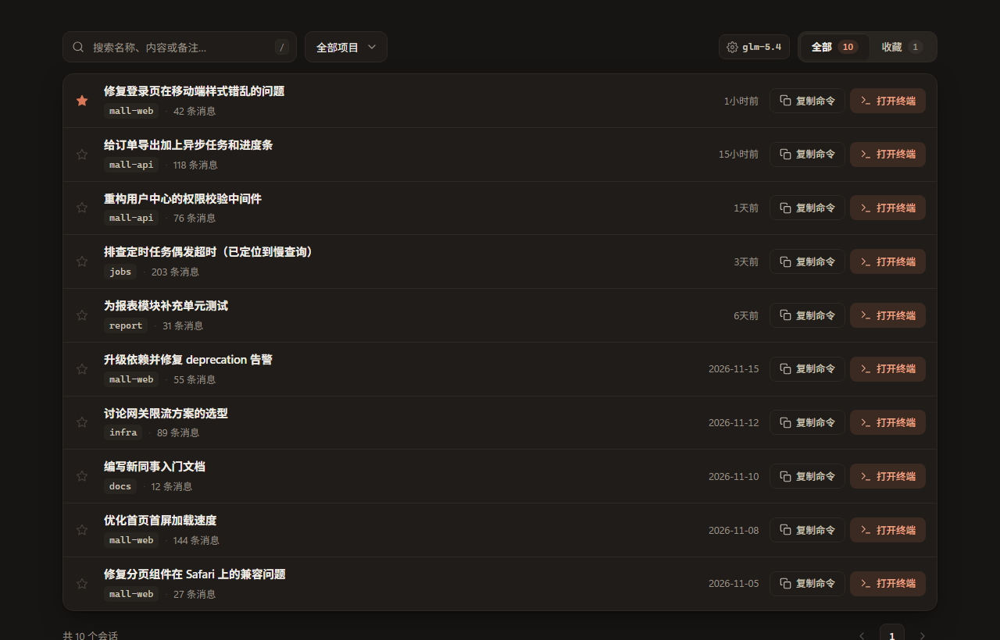

# Claude 会话管理（claude_message_view）

__一个单文件的本地 Web 服务，扫描 Claude Code 在本机留下的会话记录，提供浏览、全文搜索、收藏归档，并把任意会话一键在终端里恢复（`claude --resume`）。__

[English](README.md) · 简体中文

---

> 这是一个只跑在本机（127.0.0.1）的小工具：Claude Code 会把每个会话存成 `~/.claude/projects/*/*.jsonl`，但默认只保留 30 天，也没有一个好用的图形界面去找回某个旧会话。这个项目把浏览、搜索、收藏、备份、恢复做成一个零依赖的单文件服务。

## ✨ 项目亮点

- __🗂️ 单文件、零依赖__ — 全部代码在 `app.py` 里（服务 + 内嵌前端页面），只用 Python 标准库，`python app.py` 即可运行。
- __🔍 全文搜索__ — 按名称 / 内容 / 备注搜索，输入 ≥2 个字符时自动扫描全部会话记录找命中（带 4 秒时间预算，超时返回部分结果；本机 176MB 记录全量扫描约 2 秒）。
- __⭐ 收藏自动备份__ — 收藏的会话自动备份到 `archive/`，被 Claude Code 的 30 天清理删掉后仍留在收藏列表里（标「已归档」）。
- __♻️ 一键恢复__ — 点「恢复会话」把归档副本写回原位，继续 resume；点「打开终端」在最近使用的 Windows Terminal 窗口里新开标签页，用 PowerShell 7 直接 resume，无需复制粘贴。
- __🗂️ 归档视图__ — 「归档」页签列出所有备份（不管是否还在收藏），可恢复或删除备份。
- __⏰ 临期提示__ — 距 30 天清理还剩一周内的会话会提示「还有 N 天被清理」；页面开着时每 30 秒轮询，发现新会话在右下角提示。
- __🌗 白天 / 夜晚模式__ — 设置里可切换外观、自定义 `--model` 参数（同时作用于「复制命令」和「打开终端」）。

## 🖼️ 界面预览

| 主列表 | 会话详情 | 设置 | 夜晚模式 |
| --- | --- | --- | --- |
|  |  |  |  |

> 截图均为演示数据，非真实会话。

## 🧰 环境要求（已在以下版本验证）

| 组件 | 版本 | 说明 |
| --- | --- | --- |
| Windows | 11（10.0.26200） | 服务、注册表自启均依赖 Windows |
| Python | 3.10.4 | 仅用标准库，无第三方依赖；3.8+ 应均可 |
| Claude Code | 2.1.321 | 提供被扫描的会话记录和 `claude --resume` 命令 |
| Windows Terminal | 1.25 | 「打开终端」按钮依赖 `wt.exe`，需在 PATH 中 |
| PowerShell | 7.7.0（pwsh） | 「打开终端」在新标签页里用 pwsh 执行命令 |

不满足 Windows Terminal / pwsh 时，「复制命令」不受影响，仍可粘贴到任意终端使用。

## 🚀 快速开始

```powershell
cd path\to\claude_message_view
python app.py            # 前台运行，默认 http://127.0.0.1:8765
```

服务只监听 `127.0.0.1`，不对外网开放。

### 开机自启（可选）

```powershell
python app.py --install    # 注册表 Run 键 + VBS 启动器，开机自动启动并打开浏览器
python app.py --uninstall  # 取消自启
```

## 📖 使用流程

1. 浏览器访问 `http://127.0.0.1:8765/`。
2. 找到要继续的会话（搜索或按项目筛选；快捷键 `/` 聚焦搜索框）。
3. 点「打开终端」直接恢复；或点「复制命令」把带 `cd` 的完整 resume 命令粘贴到任意终端执行。

> 注意：Claude Code 默认只在本机保留 30 天内的会话记录（`cleanupPeriodDays`），更早的会话不会出现在列表里——收藏过的话可以在「归档」里找回。

## 🏗️ 实现要点

- __增量解析__ — 按 mtime 缓存每个 jsonl 的解析结果，未修改的文件不重读，刷新页面开销很小。
- __坏数据容错__ — jsonl 里的坏字节、坏行会被跳过，不影响整个会话。
- __安全边界__ — resume 命令只作用于缓存中真实存在的会话；模型名经白名单校验后才拼进命令行；服务只监听本机回环地址。

## 📂 项目结构

```
app.py                        # 全部代码（服务 + 内嵌前端页面），约 1500 行
docs/                         # 文档截图（演示数据）
archive/                      # 收藏会话的备份副本 + meta.json（运行时生成，不入库）
favorites.json                # 收藏与备注（运行时生成，不入库）
settings.json                 # 页面设置（模型、外观），运行时生成，不入库
claude_message_view_startup.vbs  # 开机自启启动器（--install 生成）
startup.log                   # 自启日志
```

## ⚠️ 已知限制

- 只扫描 `~/.claude/projects/*/*.jsonl` 一层，不包含子代理（subagents）的记录。
- 「打开终端」的目标是“最后使用的 Windows Terminal 窗口”（`wt -w last`），多窗口时取决于焦点。
- 全文搜索按会话时间从新到旧扫描，超过约 4 秒停止并提示结果可能不完整。
- 归档备份是完整文件副本，收藏多个大会话时 `archive/` 会占用相应磁盘空间。
- 在归档功能上线之前就被清理掉的收藏（没有备份副本）无法恢复，只保留收藏 id 与备注。

## 📄 许可证

基于 [MIT License](LICENSE) 发布。

---

为用 Claude Code 干活的人顺手打造。

_Claude 会话管理 — never lose a session again._
